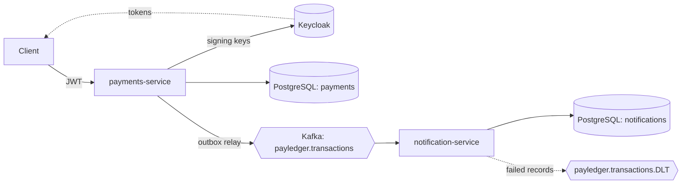

# PayLedger design

This document explains the decisions behind PayLedger, what each one costs, and what was left out on purpose. The README covers how to run it.

## Problem

Move money between customer accounts so that:

1. Money is never created or lost, even under concurrent requests and crashes.
2. A client can retry any request without being charged twice.
3. Other systems learn about every committed movement, and never about one that was rolled back.
4. When something goes wrong, an operator can see where and why.

**Non-goals:** currency exchange, card or bank networks, a frontend, multi-region deployment.

## Architecture

There are two services, and each has its own database. They share only the JSON shape of the event. That is enough to show a real service boundary, asynchronous messaging and failure isolation, without splitting into many small services that would mostly add operational cost.

## Decisions

### 1. Double-entry ledger, append-only

Every transaction writes one debit and one credit for the same amount. Entries are never updated or deleted; a correction would be a new, reversing transaction. Deposits come from a system account per currency, which may go negative. So in each currency the balances always sum to zero, and `LedgerInvariantsIT` checks this after 200 concurrent deposits.

`accounts.balance_minor` is a cached value, updated in the same transaction as the entries, so reading a balance does not have to sum the entries.

- **Cost:** two rows per movement and a balance column that must be kept in step with the entries.
- **Alternative:** a single `balance` column with no entries. It is simpler, but it has no audit trail and no way to prove the books balance.

### 2. Money as `long` minor units

Amounts are whole paisa or cents in a `bigint`, and always positive. The direction is a separate column.

- **Why:** floating-point rounding errors are impossible, and `BigDecimal` scale bugs cannot happen.
- **Cost:** currencies with three decimal places would need a per-currency exponent, which is not needed for BDT, EUR or USD.

### 3. Pessimistic locks, taken in id order

A transfer locks both accounts with `SELECT … FOR UPDATE`, always the smaller id first, then checks the funds and writes the entries. Locking in a fixed order means two opposite transfers (A→B and B→A) cannot deadlock. `ConcurrentTransfersIT` runs 200 random transfers across 6 accounts on 20 threads and checks that there is no deadlock, no negative balance, and no money lost.

- **Alternative:** optimistic locking with a version column. It needs no row locks, but hot accounts would fail and retry constantly. Payments favour correctness under contention over peak throughput.
- **Limit:** a single very hot account serializes its own transfers. Sharding or batching would be the next step.

### 4. Idempotency keys stored in the database

`POST /transfers` and `POST /deposits` require an `Idempotency-Key`. A servlet filter claims `(caller, key)` with an insert, stores a SHA-256 hash of the request, and saves the response when the request finishes.

| Situation | Result |
| --- | --- |
| Same key, same request, already finished | The stored response is replayed |
| Same key, still running | `409` |
| Same key, different request | `422` |
| A `5xx` error | The key is released so the client can retry |

`parallelDuplicatesProduceExactlyOneTransfer` sends the same request 10 times at once and checks that exactly one transfer happens.

- **Why the database and not Redis:** the key and the money movement are in the same PostgreSQL instance, so there is no second system that could disagree with it.
- **Cost:** one extra write per request, plus a cleanup job for old keys (not built yet).

### 5. Transactional outbox, not dual writes

Writing to the database and then sending to Kafka is two systems with no shared transaction. A crash in between loses the event; a rollback after sending announces money that never moved. Instead, the ledger inserts the event into `outbox_events` in the same transaction as the entries. A relay then claims batches with `FOR UPDATE SKIP LOCKED`, sends them, and stamps `published_at` only after Kafka acknowledges (`acks=all`, idempotent producer).

- **Guarantee:** at-least-once delivery. A crash after sending but before stamping re-sends the event, so consumers must deduplicate.
- **Ordering:** events are keyed by transaction id. Ordering per account is not guaranteed, and the consumer does not need it.
- **Alternative:** change data capture (Debezium) reads the database log and needs no relay code, but it adds Kafka Connect to run and operate. For two services, a relay you can read and test is the simpler choice.
- **Cost:** up to 500 ms of delay between commit and publish (the relay's polling interval), and the outbox table grows until a cleanup job exists.

### 6. Idempotent consumer, retries and a dead letter topic

notification-service inserts the event id into `processed_events` with `ON CONFLICT DO NOTHING`, in the same transaction as the notifications. A redelivered event finds the row and does nothing.

| Failure | Handling |
| --- | --- |
| Temporary, such as the database being busy | Retried after 0.5 s, 1 s and 2 s |
| Permanent, such as bad JSON or a missing field | Not retried; sent straight to `payledger.transactions.DLT` |
| A failure that outlasts the retries | Sent to the DLT with the original topic, partition and offset in headers |

In every case the partition keeps moving, so one bad message never blocks the ones behind it.

- **Alternative:** non-blocking retry topics (`@RetryableTopic`). They avoid stalling the partition during retries, but add more topics and allow messages to be processed out of order. Short in-place retries are enough here.

### 7. Security: tokens, ownership and 404 instead of 403

payments-service validates Keycloak JWTs: signature, issuer, expiry and the `payledger-api` audience. The caller is the token's `sub`, never a header or a body field. Roles decide what a caller may do (only an `ADMIN` can deposit). Ownership decides which data they can reach: another customer's account returns `404`, not `403`, so account ids cannot be probed.

### 8. Observability built around symptoms

- **Business counters are recorded after commit,** so rolled-back work never shows up on a dashboard.
- **The key alert is `payledger_outbox_oldest_pending_age_seconds`.** It rises whenever the relay or Kafka is stuck, which is what a customer would notice first.
- **The request's W3C `traceparent` is saved in the outbox row.** The relay resumes it when it sends later on another thread, so one trace covers HTTP → database → Kafka → consumer.

### 9. Delivery

- **Images:** one multi-stage `Dockerfile` builds layered, non-root JRE images.
- **CI:** runs every test, including the Testcontainers ones, before building the images, and pushes them to GHCR from `main`.
- **Helm chart:** readiness includes the database. A pod that loses its database stops receiving traffic instead of being restarted; restarting would not fix the database and would turn an outage into a restart storm.

## Failure modes

| What fails | What happens |
| --- | --- |
| payments-service crashes in the middle of a transfer | The transaction rolls back: no entries, no outbox row, no event |
| Crash after Kafka acknowledges but before `published_at` is stamped | The event is sent again; the consumer's `processed_events` drops the duplicate |
| Kafka is down | Transfers keep working; events wait in the outbox and the oldest-pending-age alert fires |
| notification-service is down | Events wait in Kafka; consumer lag grows; nothing is lost |
| A malformed event | It goes to the DLT and the next message is processed |
| The client times out and retries | The same `Idempotency-Key` replays the first response |
| The database is down | Readiness fails and Kubernetes stops sending traffic; the pods recover without restarting |

## Known limits and next steps

- Cleanup jobs for published outbox rows and expired idempotency keys.
- Rows that can never be published (a poison outbox row) are retried forever; they need an attempt count and a parking state.
- The outbox relay polls every 500 ms. An after-commit signal could wake it immediately and cut that delay.
- Hot accounts serialize their own transfers (see decision 3).
- One PostgreSQL primary and one region.
